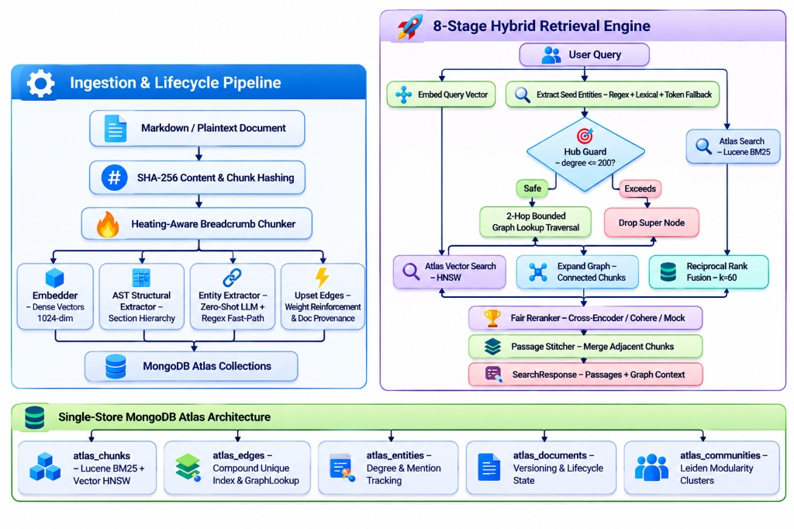

# `graphrag-atlas`

<p align="center">
  <a href="https://pypi.org/project/graphrag-atlas/"></a>
  <a href="https://pepy.tech/project/graphrag-atlas"></a>
  <a href="https://github.com/R-Mabasha/graphrag-atlas/actions/workflows/ci.yml"></a>
  <a href="https://opensource.org/licenses/MIT"></a>
  <a href="https://www.python.org/downloads/"></a>
  <a href="https://www.mongodb.com/atlas"></a>
  <a href="https://github.com/astral-sh/ruff"></a>
  <a href="CONTRIBUTING.md"></a>
  <a href="https://github.com/R-Mabasha/graphrag-atlas"></a>
</p>

<p align="center">
  <strong>Production-grade Single-Store Hybrid GraphRAG on MongoDB Atlas.</strong><br />
  <em>Unifying BM25 Lexical Search, Dense HNSW Vectors, AST Hierarchies, and Bounded 2-Hop GraphLookup in One Database. Zero Neo4j. Zero Multi-DB Sprawl.</em>
</p>

> **TL;DR:** Stop orchestrating separate vector databases, graph databases, and relational document stores. `graphrag-atlas` gives you an **end-to-end GraphRAG lifecycle** directly inside MongoDB Atlas using native `$search`, `$vectorSearch`, and `$graphLookup` with automatic index provisioning, Hub Guard circuit breaking, two-tier tenancy, and chunk-level diff caching.

<p align="center">
  
</p>

---

## Why `graphrag-atlas`?

Most GraphRAG implementations force difficult trade-offs:
1. **Multi-Database Sprawl:** Running separate vector databases (Qdrant, Pinecone), graph databases (Neo4j), and relational metadata stores.
2. **Offline Batch Only:** Generating massive offline parquets without interactive updates or multi-tenant query isolation.
3. **Naive Traversal:** Using basic `$graphLookup` without hub node circuit breakers or multi-modal fusion.

`graphrag-atlas` eliminates database sprawl by orchestrating an **end-to-end production GraphRAG lifecycle inside a single MongoDB Atlas cluster**:
- **Ingestion & Lifecycle Pipeline:** Content-hashed deduplication, heading-aware breadcrumb chunking, 1024-dim dense embeddings, AST structural hierarchy, and multi-document corroborated edge upserting.
- **Single-Store Atlas Architecture:** Chunks (`atlas_chunks`), Edges (`atlas_edges`), Entities (`atlas_entities`), Documents (`atlas_documents`), and Communities (`atlas_communities`).
- **8-Stage Hybrid Retrieval Engine:** Concurrent BM25 + Vector Search + Entity Fallback -> Hub Guard circuit breaker (`degree <= 200`) -> Bounded 2-hop `$graphLookup` traversal -> Reciprocal Rank Fusion ($k=60$) -> Fair Cross-Encoder Reranking -> Adjacent Passage Stitching.
- **Two-Tier Hierarchical Tenancy:** Native support for top-level organizations (`tenant_id`) and workspaces (`project_id`), supporting scoped or tenant-wide federated queries with compound index optimization.

---

## Feature Comparison

| Capability | `langchain-mongodb` (`MongoDBGraphStore`) | `Cognee` | `graphrag-atlas` |
|---|---|---|---|
| **Storage Backend** | MongoDB | Pluggable multi-store | **Single MongoDB Atlas Cluster** |
| **Search Modalities** | Vector + Flat Graph | Vector + Graph | **BM25 + Vector + 2-hop Graph** |
| **Fusion Algorithm** | Naive list concatenation | LLM stitching | **Reciprocal Rank Fusion (RRF, $k=60$)** |
| **Super-node Protection** | None (risks exponential fan-out) | None | **Hub Guard Circuit Breaker (`degree > 200`)** |
| **Document Structure** | Flat text | Flat text | **AST Section Hierarchy + Semantic Triples** |
| **Community Detection** | None | Hierarchical | **Dynamic Leiden Clustering with Atomic Versioning** |
| **Lifecycle & Pruning** | Manual | Manual | **Chunk-level SHA-256 diffing, cascading deletes & orphan cleanup** |
| **Multi-Tenancy** | Application-level | Application-level | **Two-Tier Native Compound Indexing (`tenant_id` + `project_id`)** |

---

## Installation

```bash
# Minimal installation (core engine)
pip install graphrag-atlas

# With OpenAI support
pip install "graphrag-atlas[openai]"

# With AWS Bedrock support
pip install "graphrag-atlas[aws]"

# With all providers and document parsers (PDF, DOCX, XLSX)
pip install "graphrag-atlas[all]"
```

---

## Quickstart

```python
import asyncio
from graphrag_atlas import AtlasGraphRAG, GeneralDomainPack

async def main():
    # 1. Initialize RAG with unified provider resolver
    # Automatically reads credentials (OPENAI_API_KEY or AWS Bedrock) from environment
    rag = AtlasGraphRAG(
        mongo_uri="mongodb+srv://cluster.mongodb.net/",
        database="knowledge_base",
        tenant_field="tenant_id",
        provider="openai",  # or "aws"
        domain_pack=GeneralDomainPack()
    )

    # 2. Deploy Atlas indexes (B-Tree, Multikey, Compound Tenant, Vector & Lucene BM25 Search)
    await rag.setup_indexes()

    # 3. Ingest documents with automated AST hierarchy and entity extraction
    # Supports two-tier tenancy with optional project_id scoping
    doc_id = await rag.ingest(
        file_path="./system_architecture.pdf",
        tenant_id="client_alpha",
        project_id="workspace_backend"
    )
    print(f"Ingested document: {doc_id}")

    # 4. Hybrid Search across BM25 + Vector + Graph
    # Project-scoped search (or omit project_id for tenant-wide federated search)
    response = await rag.search(
        query="Which services communicate with the payment processing pipeline?",
        tenant_id="client_alpha",
        project_id="workspace_backend",
        top_k=5
    )

    for passage in response.passages:
        print(f"[{passage.score:.3f}] {passage.text}\n")

    print("Discovered Graph Entities:", response.graph_entities)

if __name__ == "__main__":
    asyncio.run(main())
```

---

## Two-Tier Tenancy

Organizations often require sub-partitioning by project, workspace, or environment:

```python
# Project-scoped query: searches strictly within workspace_backend
resp = await rag.search(
    query="API rate limits",
    tenant_id="org_enterprise",
    project_id="workspace_backend"
)

# Cross-project query: searches across all projects in the organization
all_resp = await rag.search(
    query="Corporate compliance policies",
    tenant_id="org_enterprise",
    project_id=None
)
```

---

## End-to-End Lifecycle Management

`graphrag-atlas` provides enterprise lifecycle operations that keep knowledge graphs fresh, consistent, and performant:

```python
# Incremental re-ingestion (only modified chunks are re-embedded and re-extracted)
await rag.reingest(file_path="./system_architecture.pdf", tenant_id="client_alpha")

# Soft-archiving (recalibrates active entity degrees, hides from search without data loss)
await rag.archive_document(tenant_id="client_alpha", document_id="doc_123")

# Restoration
await rag.restore_document(tenant_id="client_alpha", document_id="doc_123")

# Hard cascading delete with multi-document provenance preservation
# If other documents corroborate an edge, weight is decremented without breaking the relationship
await rag.delete_document(tenant_id="client_alpha", document_id="doc_123")

# Tenant health analytics & graph integrity
stats = await rag.get_tenant_stats(tenant_id="client_alpha")
print(f"Active docs: {stats.active_documents}, Edges: {stats.active_edges}")
```

---

## Domain Packs

Domain logic is completely decoupled from the retrieval engine. You can use the built-in `GeneralDomainPack` (zero-shot LLM extraction) or define custom domain rules:

```python
from graphrag_atlas.domain import DomainPack, RelationSpec

finance_pack = DomainPack(
    name="finance",
    ontology=[
        RelationSpec("SETTLES_VIA", direction="directed"),
        RelationSpec("POSTS_TO", direction="directed"),
        RelationSpec("RECONCILES_WITH", direction="undirected"),
    ],
    acronyms={"GL": "General Ledger", "AP": "Accounts Payable"},
    domain_vocabulary={"settlement", "clearing", "ledger", "journal"}
)
```

---

## ⭐ Star History

If you find `graphrag-atlas` helpful for your project or enterprise, please consider giving it a star! It helps more developers discover the framework.

<p align="center">
  <a href="https://star-history.com/#R-Mabasha/graphrag-atlas&Date">
    
  </a>
</p>

---

## 🤝 Contributing

Contributions are welcome! Please check out [CONTRIBUTING.md](CONTRIBUTING.md) for development setup, guidelines, and PR workflows.

---

## 📖 Citation

If you use `graphrag-atlas` in academic research, benchmarks, or enterprise applications, please cite:

```bibtex
@software{graphrag_atlas_2026,
  author = {R, Mabasha},
  title = {graphrag-atlas: Single-Store Hybrid GraphRAG on MongoDB Atlas},
  year = {2026},
  url = {https://github.com/R-Mabasha/graphrag-atlas}
}
```

---

## 📄 License

MIT License. See [LICENSE](LICENSE) for details.
